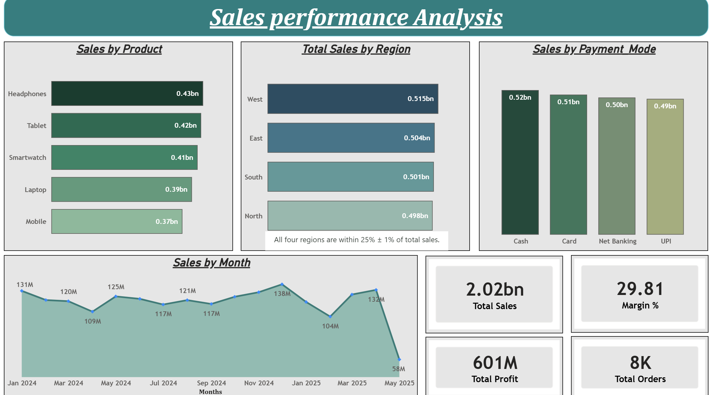
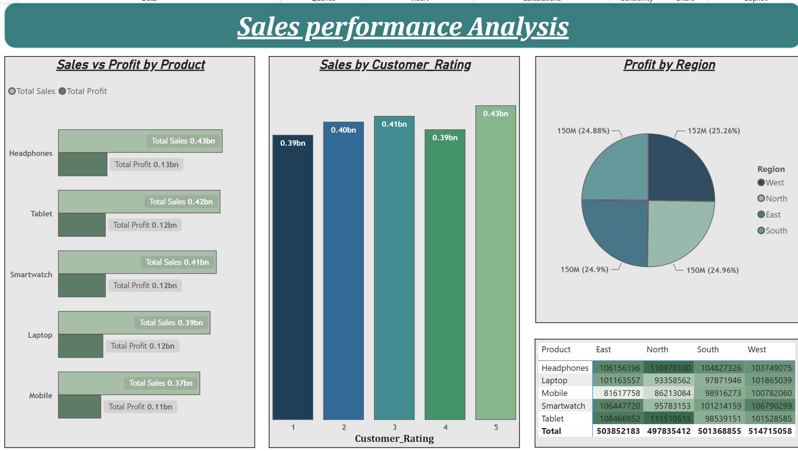
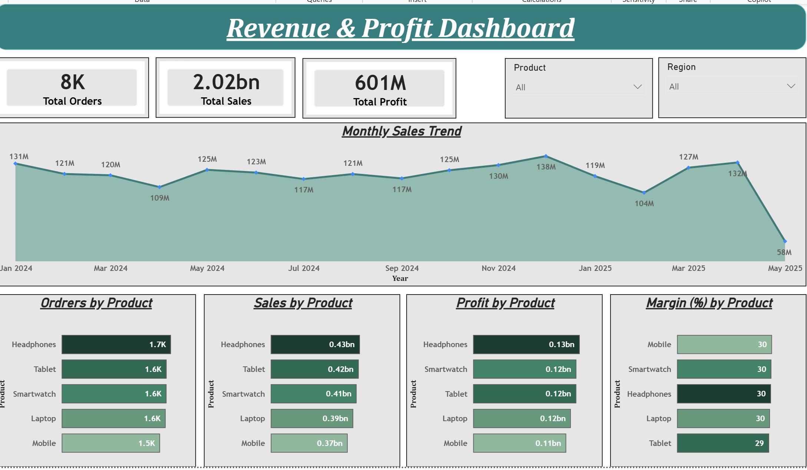
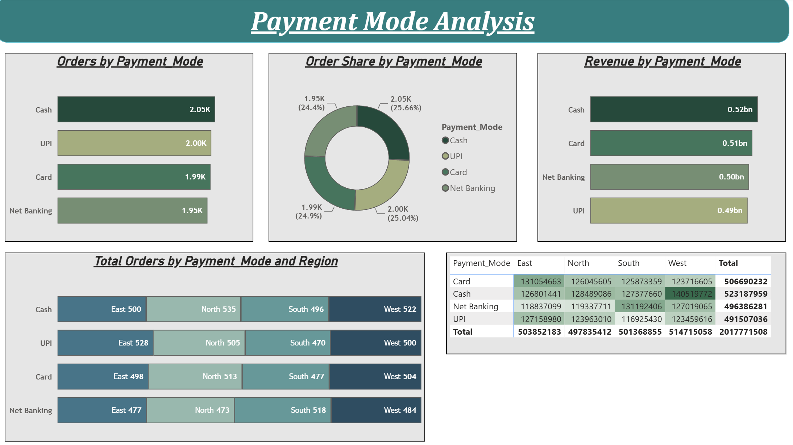
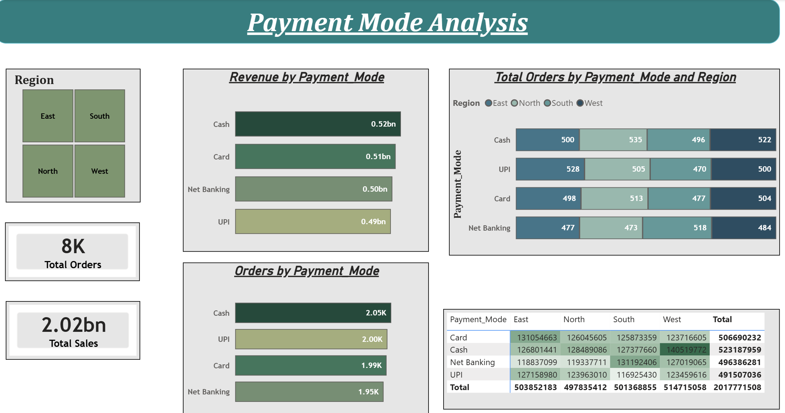
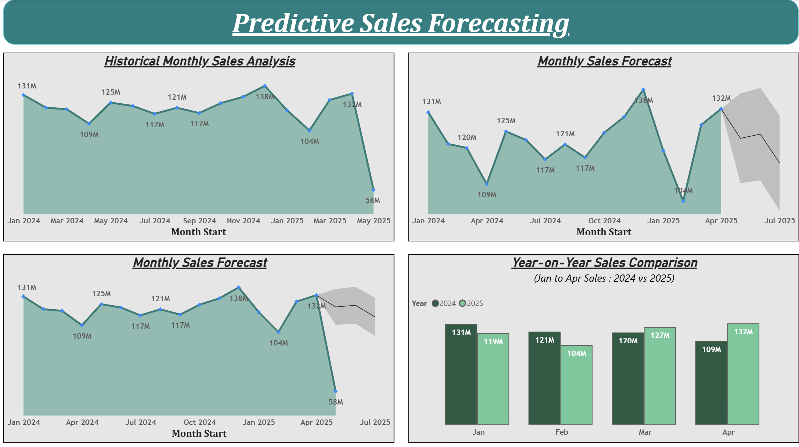
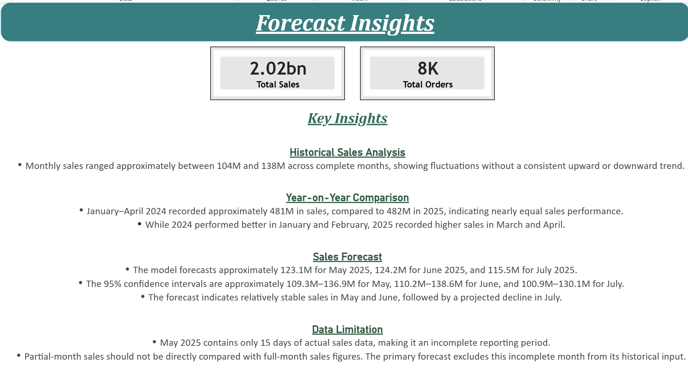
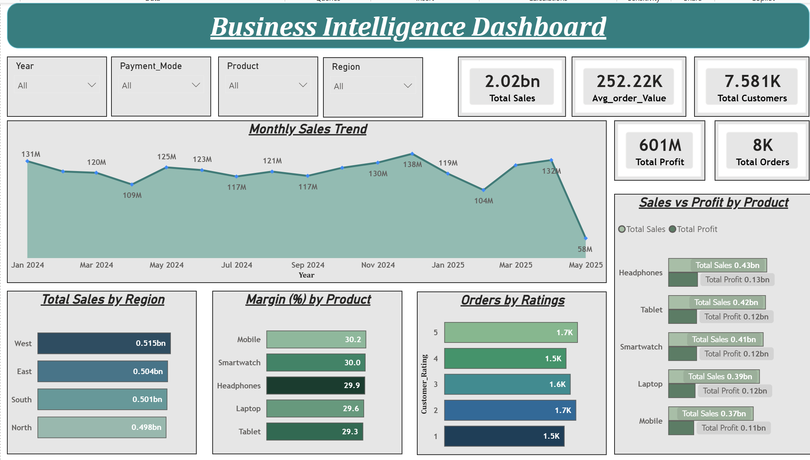

# Sales Data Analytics

## Problem Statement

This project focuses on analyzing the sales performance of an electronics business selling laptops, mobiles, tablets, smartwatches and headphones across four regions. The business recorded 8,000 sales orders between January 2024 and 15 May 2025.

Using Power BI, interactive dashboards are developed to analyze:

- **Sales Performance:** Total sales, profit, profit margin and order volume.
- **Regional and Product Analysis:** Sales and profit across different regions and products.
- **Payment Analysis:** Orders and revenue by payment mode and region.
- **Customer Insights:** Overall customer count, average order value and sales distribution across customer ratings.
- **Sales Forecasting:** Historical monthly sales trends and a three-month sales forecast.

**Output:** Interactive Power BI dashboards with KPI cards, slicers, sales trends, product and regional comparisons, payment analysis, customer insights and sales forecasting.

**Limitations:**
- May 2025 contains only 15 days of sales data and is an incomplete month.
- Customer names are not reliable unique identifiers.
- The forecast is an estimate based on historical sales and is not guaranteed.

# Level 1 – Task 1: Sales Performance Analysis

## Problem Statement

The objective of this project is to analyze sales and profit performance using an interactive Power BI dashboard. The analysis focuses on calculating total sales, identifying the top 5 selling products, comparing region-wise sales, and evaluating product performance through different charts and visualizations.

The dashboard provides insights into monthly sales trends, payment methods, customer ratings, regional profitability, and product-wise sales performance, helping users understand business performance through interactive visualizations.


### Steps Followed

- Step 1 : Loaded the sales dataset into Power BI Desktop and opened Power Query Editor to examine the data structure and quality.

- Step 2 : Enabled Column Quality, Column Distribution, and Column Profile options under the View tab to inspect the dataset for empty values, errors, inconsistencies, and unusual data patterns.

- Step 3 : Reviewed the available columns and their data types. The dataset was already well-structured and did not require any major data cleaning or transformation.

- Step 4 : Renamed the imported dataset table as `sales_data` for easier identification and reference in further calculations.

- Step 5 : Inserted a Text Box on the first report page and added the title "Sales Performance Analysis". Applied appropriate formatting to improve the appearance and readability of the dashboard.

### Requirement 1: Calculate Total Sales

- Step 6 : Created a new DAX measure named `Total Sales` in the `sales_data` table using the `SUM()` function to calculate the overall sales amount.

  ```dax
  Total Sales = SUM(Sales_data[Sales])
  ```

- Step 7 : Created a separate Measure Table to organize the DAX measures in one place and moved the `Total Sales` measure into it for better management.

- Step 8 : Added a Card visual to the report page and used the `Total Sales` measure to display the overall sales value. The measure dynamically calculates total sales according to the applied filters and selections in the report.

### Requirement 2: Identify Top 5 Selling Products

- Step 9 : Created a horizontal Bar Chart to compare sales across different products. Added Product to the Y-axis and the `Total Sales` measure to the X-axis, allowing Power BI to calculate and display sales for each product category.

- Step 10 : Applied a Top N filter from the Filters pane and configured it to display the Top 5 products based on `Total Sales`.

- Step 11 : Formatted the visual and renamed it as "Sales by Product" to provide a clear comparison of the highest-selling products.

### Requirement 3: Compare Region-wise Sales

- Step 12 : Created a horizontal Bar Chart to compare Total Sales across different regions, using Region on the Y-axis and the `Total Sales` measure on the X-axis. Renamed the visual as "Total Sales by Region".

- Step 13 : Created a new DAX measure named `Sales % of Total` to calculate the percentage contribution of each region to overall sales.

  ```dax
  Sales % of Total =
  DIVIDE(
      [Total Sales],
      CALCULATE(
          [Total Sales],
          ALL(Sales_data[Region])
      )
  )
  ```

- Step 14 : Used the `DIVIDE()` function to calculate the ratio of regional sales to overall sales. The `CALCULATE()` function modified the filter context, while `ALL()` removed the filter on the Region column to calculate total sales across all regions.

- Step 15 : Added the `Sales % of Total` measure to the tooltip of the regional sales chart so that users can view each region's percentage contribution to overall sales by hovering over the corresponding bars.

- Step 16 : Formatted the measure as a percentage to display the regional contribution in percentage format, making it easier to compare the sales distribution across different regions.

### Requirement 4: Create Basic Charts and Graphs

- Step 17 : Created a Clustered Column Chart to analyze sales across different payment methods, using Payment Mode on the X-axis and Total Sales on the Y-axis. Renamed the visual as "Sales by Payment Mode".

- Step 18 : Created a calculated column named `Month Start` using the `DATE()`, `YEAR()`, and `MONTH()` functions to extract the first day of each month from the Date column. This allowed transactions belonging to the same month to be grouped together for monthly sales analysis.

  ```dax
  Month Start =
  DATE(
      YEAR(Sales_data[Date]),
      MONTH(Sales_data[Date]),
      1
  )
  ```

- Step 19 : Created a Line Chart to analyze monthly sales trends over time, using Month Start on the X-axis and Total Sales on the Y-axis. Renamed the visual as "Sales by Month".

- Step 20 : Created a DAX measure named `Total Profit` using the `SUM()` function to calculate the overall profit.

  ```dax
  Total Profit = SUM(Sales_data[Profit])
  ```

- Step 21 : Created a DAX measure named `Margin %` to calculate the profit margin by dividing Total Profit by Total Sales and multiplying the result by 100.

  ```dax
  Margin % = DIVIDE([Total Profit],[Total Sales])*100
  ```

- Step 22 : Created a DAX measure named `Total Orders` using the `COUNTROWS()` function to calculate the total number of orders.

  ```dax
  Total Orders = COUNTROWS(Sales_data)
  ```

- Step 23 : Added Card visuals to display Total Profit, Margin %, and Total Orders as key performance indicators (KPIs) on the dashboard.

- Step 24 : Created a Clustered Bar Chart to compare Total Sales and Total Profit across different products, using Product on the Y-axis and Total Sales and Total Profit on the X-axis. Added Margin % to the tooltip to display additional profitability information when hovering over the bars. This visual helps identify products with higher sales and compare their corresponding profit performance.

- Step 25 : Created a Clustered Column Chart to analyze sales distribution across different customer ratings, using Customer Rating on the X-axis and Total Sales on the Y-axis. Renamed the visual as "Sales by Customer Rating" to understand how sales vary across different customer rating categories.

- Step 26 : Created a Pie Chart to analyze profit distribution across different regions, using Region in the Legend field and Total Profit in the Values field. Each slice represents a region, while its size indicates the corresponding profit contribution. This visual helps identify the regions contributing more towards overall profitability.

- Step 27 : Created a Table visual to display product-wise sales across different regions, using Product in Rows, Region in Columns, and Total Sales in Values. This provides a structured comparison of sales performance across products and regions.

### Sales Performance Analysis

The Sales Performance Analysis pages look like:




# Level 2 – Task 1: Revenue & Profit Dashboard

## Problem Statement

The objective of this dashboard is to provide an interactive analysis of sales, profit, and order performance. It allows users to monitor key performance indicators (KPIs), analyze monthly sales trends, compare product performance, and filter the report by region and product.

### Steps Followed

- Step 1 : Created a new report page and inserted a Text Box with the title "Revenue & Profit Dashboard". Applied appropriate formatting to maintain a consistent dashboard design.

### Requirement 1: Create KPI Cards for Total Sales, Total Profit, and Total Orders

- Step 2 : Added three Card visuals using the previously created `Total Sales`, `Total Profit`, and `Total Orders` DAX measures to display the key business metrics. These KPI cards provide a quick overview of overall sales performance, profitability, and order volume.

### Requirement 2: Monthly Sales Trend Analysis

- Step 3 : Added a Line Chart to analyze monthly sales trends, using the previously created `Month Start` calculated column on the X-axis and the `Total Sales` measure on the Y-axis.

- Step 4 : Formatted the visual and renamed it as "Monthly Sales Trend". This chart helps identify monthly sales fluctuations and understand changes in sales performance over time.

### Requirement 3: Region and Product Filters

- Step 5 : Added two Dropdown Slicers using Region and Product from the `Sales_data` table to enable interactive filtering of the dashboard.

- Step 6 : Configured the slicers to allow users to analyze sales, profit, and orders for selected regions and products. These filters make it easier to compare specific business segments without creating separate reports.

### Requirement 4: Product Comparison Charts

- Step 7 : Created a Clustered Bar Chart to compare order volume across different products, using Product on the Y-axis and the `Total Orders` measure on the X-axis. Renamed the visual as "Orders by Product" to identify products receiving higher or lower numbers of orders.

- Step 8 : Created a Clustered Bar Chart to compare product-wise sales, using Product on the Y-axis and the `Total Sales` measure on the X-axis. Renamed the visual as "Sales by Product" to identify products generating higher sales revenue.

- Step 9 : Created a Clustered Bar Chart to analyze product-wise profitability, using Product on the Y-axis and the `Total Profit` measure on the X-axis. Renamed the visual as "Profit by Product" to compare the profit contribution of different products.

- Step 10 : Created a Clustered Bar Chart to compare profit margins across products, using Product on the Y-axis and the `Margin %` measure on the X-axis. Renamed the visual as "Margin (%) by Product" to evaluate the profitability of each product relative to its sales.

- Step 11 : Applied consistent formatting, colors, and data labels across the visuals to improve readability and enable easy comparison of product performance.

### Revenue & Profit Dashboard

The Revenue & Profit Dashboard page looks like this :



# Level 2 – Task 3: Payment Mode Analysis

## Problem Statement

The objective of this project is to analyze customer payment preferences and understand how customers use different payment methods, including UPI, Card, Cash, and Net Banking.

The dashboard focuses on comparing transaction volumes, analyzing revenue generated through different payment methods, and studying regional payment trends. It provides an interactive view of payment preferences and revenue distribution across different regions through charts, slicers, and tabular visualizations.

### Steps Followed

- Step 1 : Created a new report page and inserted a Text Box with the title "Payment Mode Analysis". Applied appropriate formatting to maintain a consistent dashboard design.

### Requirement 1: Compare UPI, Card, Cash, and Net Banking Usage

- Step 2 : Created a horizontal Bar Chart to compare the number of orders across different payment methods, using Payment Mode on the Y-axis and Total Orders on the X-axis. Renamed the visual as "Orders by Payment Mode". This helps identify the most and least frequently used payment methods.

- Step 3 : Created a Donut Chart to display the percentage distribution of orders across different payment methods, using Payment Mode in the Legend field and Total Orders in the Values field. Renamed the visual as "Order Share by Payment Mode". This provides a proportional view of customer payment preferences.

### Requirement 2: Calculate Revenue by Payment Method

- Step 4 : Created a horizontal Bar Chart to compare revenue generated through different payment methods, using Payment Mode on the Y-axis and Total Sales on the X-axis. Renamed the visual as "Revenue by Payment Mode". This helps identify which payment methods contribute more towards overall sales revenue.

### Requirement 3: Analyze Region-wise Payment Trends

- Step 5 : Created a 100% Stacked Bar Chart to analyze the regional distribution of orders across different payment methods, using Payment Mode on the Y-axis, Total Orders on the X-axis, and Region in the Legend field. Renamed the visual as "Total Orders by Payment Mode and Region". This allows users to compare the percentage distribution of payment methods across different regions.

- Step 6 : Created a Matrix visual to display Total Sales across different payment methods and regions, using Payment Mode in Rows, Region in Columns, and Total Sales in Values. This provides a detailed breakdown of revenue generated through each payment method across different regions. The grand total represents overall sales across all payment methods and regions.

### Payment Mode Analysis

The Payment Mode Analysis page looks like this:



### Requirement 4: Create Reports and Visualizations

- Step 7 : Created a second report page and inserted a Text Box with the title "Payment Mode Analysis". Applied appropriate formatting to maintain consistency across both report pages.

- Step 8 : Added a Tile-style Slicer using the Region field to allow users to select individual regions. This enables interactive analysis of payment preferences and revenue performance for the selected region.

- Step 9 : Added two Card visuals to display Total Orders and Total Sales, providing an overview of the key business metrics based on the selected region.

- Step 10 : Created a Bar Chart named "Revenue by Payment Mode" to compare sales generated through Cash, Card, Net Banking, and UPI for the selected region.

- Step 11 : Created a Bar Chart named "Orders by Payment Mode" to compare the number of orders across different payment methods for the selected region.

- Step 12 : Added a 100% Stacked Bar Chart named "Total Orders by Payment Mode and Region" to provide a comparative view of regional order distribution across different payment methods.

- Step 13 : Added a Matrix visual to display Total Sales by Payment Mode across different regions, providing a detailed tabular breakdown of regional revenue.

- Step 14 : Configured the Region slicer to interact with the report visuals, allowing users to dynamically analyze payment methods, order volume, and revenue for the selected region.

### Payment Mode Analysis Visualizations

The Payment Mode Analysis Visualizations Page looks like this:



# Level 3 – Task 1: Predictive Sales Forecasting

## Problem Statement

The objective of this project is to analyze historical sales data and predict future sales trends using Power BI's built-in forecasting capabilities.

The analysis focuses on identifying historical sales patterns, generating future sales forecasts, comparing year-on-year performance, and presenting meaningful business insights to understand potential revenue trends.

### Steps Followed

- Step 1 : Reused the previously loaded `Sales_data` dataset and existing DAX measures, including `Total Sales` and `Total Orders`, for the forecasting analysis.

### Requirement 1: Analyze Historical Sales Patterns

- Step 2 : Created a Line Chart to analyze historical monthly sales performance, using the `Month Start` calculated column on the X-axis and the `Total Sales` measure on the Y-axis. Renamed the visual as "Historical Monthly Sales Analysis".

- Step 3 : Analyzed monthly sales fluctuations over time to identify variations in sales performance and understand historical trends.

### Requirement 2: Create Forecasting Charts

- Step 4 : Created a Line Chart using Month Start on the X-axis and Total Sales on the Y-axis. Enabled the built-in Forecast option from the Analytics pane in Power BI.

- Step 5 : Configured the forecasting settings with a Forecast Length of 3 periods and a Confidence Interval of 95%. Renamed the visual as "Monthly Sales Forecast (Excluding Partial May 2025)".

- Step 6 : Excluded the incomplete May 2025 reporting period from the primary forecasting analysis, as the dataset contains only 15 days of actual sales data for that month.

- Step 7 : Created an additional forecasting chart with the partial May 2025 data included to compare how an incomplete reporting period can influence the forecast. This chart was used for comparison rather than as the primary forecasting result.

### Requirement 3: Predict Future Revenue Trends

- Step 8 : Used the forecast line and its confidence interval to estimate future monthly sales revenue. The forecast provides projected sales values along with an estimated upper and lower confidence boundary.

- Step 9 : Analyzed the forecast results to understand potential future revenue trends. The projected values were treated as estimates rather than guaranteed future sales.

### Requirement 4: Year-on-Year Sales Comparison

- Step 10 : Created a calculated column named `Year` using the `YEAR()` function to extract the year from the Date column.

  ```dax
  Year = YEAR(Sales_data[Date])
  ```

- Step 11 : Created another calculated column named `Month Number` using the `MONTH()` function to extract the numerical month value from the Date column.

  ```dax
  Month Number = MONTH(Sales_data[Date])
  ```

- Step 12 : Created a calculated column named `Month Name` using the `FORMAT()` function to extract the abbreviated month name from the Date column.

  ```dax
  Month Name = FORMAT(Sales_data[Date], "MMM")
  ```

- Step 13 : Used the Sort by Column option under Column Tools to sort Month Name by Month Number, ensuring that months appear in chronological rather than alphabetical order.

- Step 14 : Created a Clustered Column Chart to compare monthly sales across different years, using Month Name on the X-axis, Total Sales on the Y-axis, and Year in the Legend field. Renamed the visual as "Year-on-Year Sales Comparison".

- Step 15 : Applied a Month Number filter from 1 to 4 to compare January through April sales for 2024 and 2025, excluding May 2025 because it contains incomplete monthly data.

### Predictive Sales Forecasting

The Predictive Sales Forecasting Page looks like this:



### Requirement 5: Prepare an Insight Report

- Step 16 : Created a separate report page named "Forecast Insights" to present the important findings obtained from historical sales analysis, year-on-year comparison, and forecasting results.

- Step 17 : Added Card visuals to display Total Sales and Total Orders, providing an overview of the overall business performance.

- Step 18 : Added a Key Insights section summarizing historical sales fluctuations, year-on-year performance, forecasted revenue trends, and data limitations.

- Step 19 : Included the forecast estimates and their confidence intervals to communicate the expected future sales range and highlight the uncertainty associated with the predictions.

- Step 20 : Highlighted the incomplete May 2025 reporting period as an important data limitation to ensure that partial-month sales are not misinterpreted as a decline in overall business performance.

### Forecast Insights

Forecast Insights Page looks like this:



# Level 3 – Task 2 & Task 3: Business Intelligence Dashboard

## Problem Statement

The objective of this project is to build a comprehensive Business Intelligence Dashboard using Power BI to analyze overall business performance.

The dashboard combines customer insights, sales trends, profitability analysis, and key performance indicators (KPIs) into a single interactive report. It allows users to explore business performance across different years, products, regions, and payment methods.

### Steps Followed

- Step 1 : Created a new report page and inserted a Shape to serve as the dashboard header. Added the title "Business Intelligence Dashboard" and applied appropriate formatting.

- Step 2 : Added four Dropdown Slicers using Year, Payment_Mode, Product, and Region fields to enable interactive filtering of the dashboard. These slicers allow users to analyze business performance across different time periods, payment methods, products, and geographical regions.

- Step 3 : Added Card visuals to display important business metrics, including Total Sales, Total Profit, Total Orders, Total Customers, and Average Order Value (Avg_order_Value). These KPI cards provide a quick overview of overall business performance, customer base, sales, and profitability.

### Dashboard Visualizations

- Step 4 : Added a Line Chart named "Monthly Sales Trend" to analyze monthly sales performance over time. This visual helps identify sales fluctuations and understand historical sales patterns.

- Step 5 : Added a horizontal Bar Chart named "Total Sales by Region" to compare sales revenue across different geographical regions and identify the regions contributing more towards overall sales.

- Step 6 : Added a horizontal Bar Chart named "Margin (%) by Product" to compare profit margins across different products and understand their relative profitability.

- Step 7 : Added a horizontal Bar Chart named "Orders by Ratings" to analyze order distribution across different customer rating categories. This provides insights into customer ratings and their relationship with order activity.

- Step 8 : Added a Clustered Bar Chart named "Sales vs Profit by Product" to compare total sales and total profit across different products. This helps evaluate product-wise revenue generation and profitability.

- Step 9 : Arranged and formatted the KPI cards, slicers, and charts into a single dashboard layout to provide a consolidated and interactive view of business performance.

- Step 10 : Configured slicer interactions with the report visuals, allowing users to dynamically explore sales, profit, customer, and product performance based on selected filters.

###  Business Intelligence Dashboard

Business Intelligence Dashboard looks like this:



## Insights

- Monthly sales show fluctuations over the analyzed period, with complete months generally ranging from approximately **104M to 138M**.
- The January–April year-on-year comparison shows total sales of approximately **481M in 2024** and **482M in 2025**, based on the rounded chart values.
- In January and February, sales were higher in 2024, at **131M and 121M**, compared with **119M and 104M** in 2025.
- In March and April, 2025 recorded higher sales, at **127M and 132M**, compared with **120M and 109M** in 2024.
- The primary three-month sales forecast estimates **123.1M for May 2025**, **124.2M for June 2025**, and **115.5M for July 2025**.
- The 95% confidence interval for the forecast is **109.3M–136.9M for May**, **110.2M–138.6M for June**, and **100.9M–130.1M for July 2025**.
- Actual sales for the first 15 days of May 2025 are approximately **58.2M**. Since this is an incomplete month, it should not be directly compared with full-month sales.
- The payment mode analysis compares order volume and revenue across UPI, Card, Cash and Net Banking, while the regional visuals show how payment activity varies across the four regions.
- Product-wise sales, profit and margin charts help compare product performance and identify differences in revenue generation and profitability.

  **Abhishek Kumar**  
Github:  [https://github.com/vk18abhishek] (https://github.com/vk18abhishek/sales-data-analytics-powerbi)
